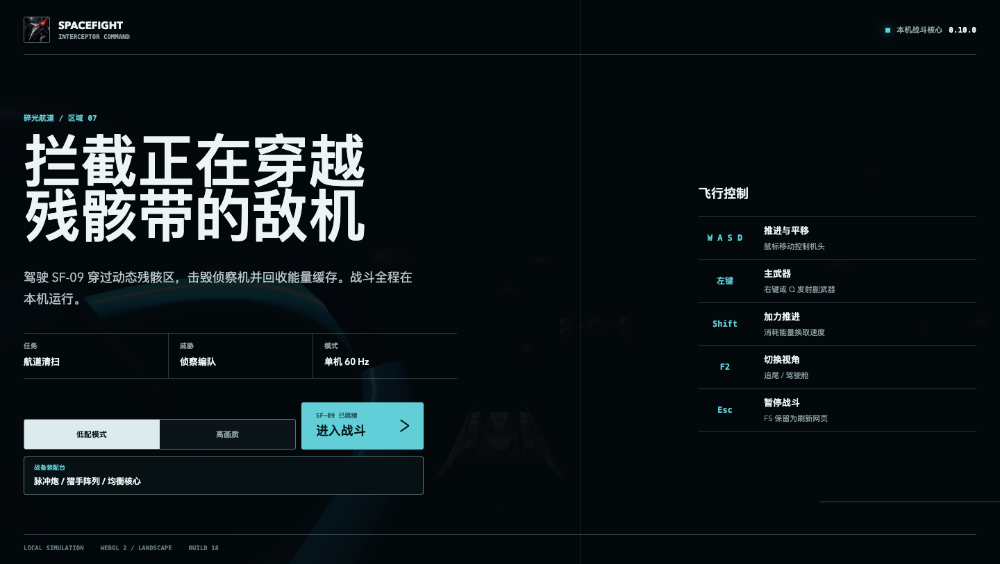
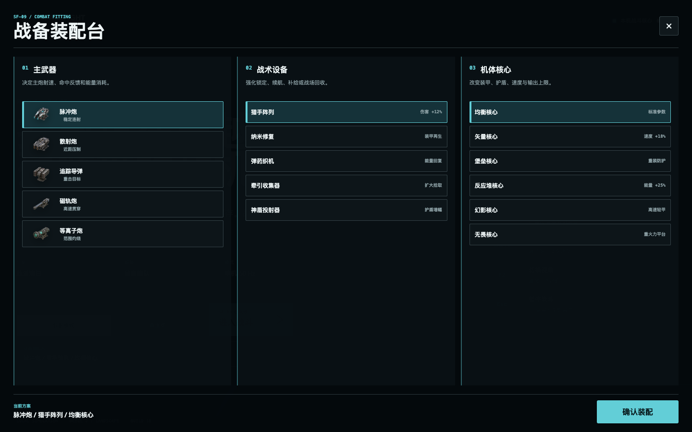
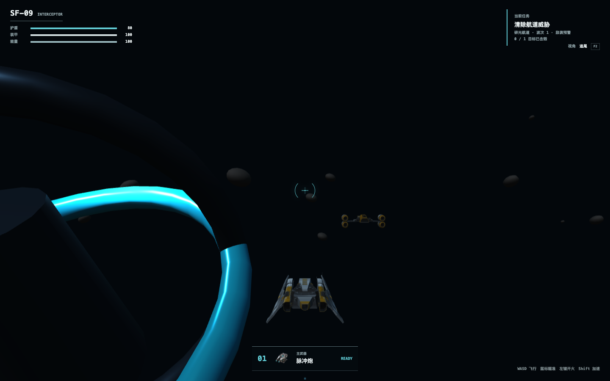
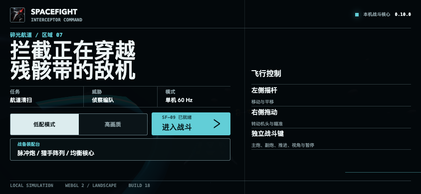
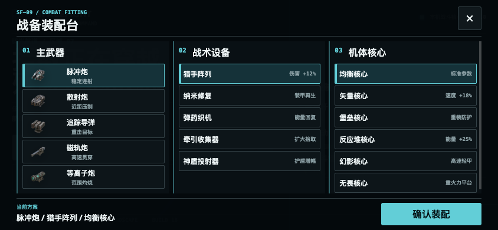
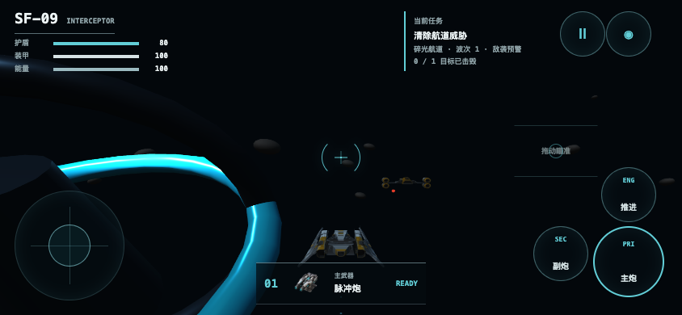
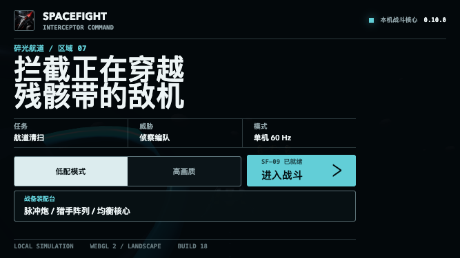
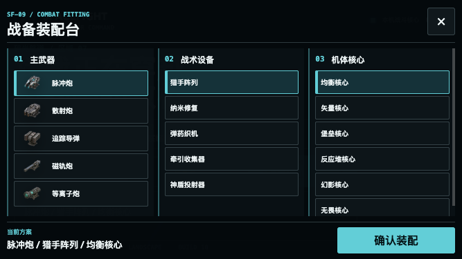
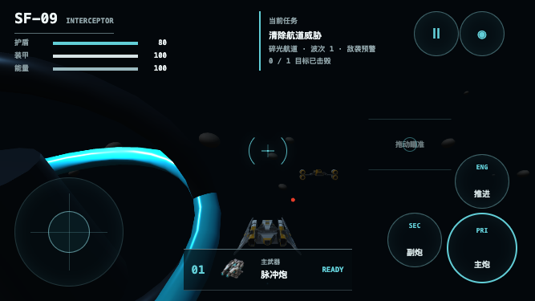

# SpaceFight 全端重构过程记录

本文从 SpaceFight 可核验的 Three.js 网页基线开始，记录 Three.js 网页、各端原生 App，以及后续 Cocos Creator 3.8.8 重构的变化。以后每次修改至少追加：问题、根因、改动、测试、构建产物、线上结果和验收截图。

## 史料与记录边界

- Three.js 阶段以 2026-08-01 切换 Cocos 前的完整备份为主要依据：`/Users/ljg/Downloads/SpaceFight-legacy-backup-20260801-130849.tar.gz`。对应 SHA-256 为 `c47d899e20ed896629d22654acddd2bd6a00a6d3a2a5dd0174aaa15471374b89`。
- 可直接阅读的网页前端副本位于 `/Users/ljg/Downloads/spacefight-web-frontend-legacy-20260801-1935`，包含 `three.min.js`、`GLTFLoader.js`、渲染、模拟、输入、WebSocket 和 UI 源码。
- 2026-07-25 之后的版本变化同时核对 `website/api/data/changelogs.json`、设计文档、实施文档与对应源码。
- Three.js 早期网页没有完整的 Git 路径历史；无法由文件时间或备份证明的细节不写成已完成事实。

## 当前边界

- 网页战斗核心已经使用 Cocos Creator 3.8.8、TypeScript、WebGL2 和 Cocos Physics。
- Android、iOS、macOS、HarmonyOS 联机版与 HarmonyOS 单机版都是原生 App，不加载网站、不包含 WebView。
- 原生 App 目前仍使用 Kotlin、Swift/SpriteKit 和 ArkTS 各自实现的本地战斗渲染；“所有 App 共用 Cocos 原生导出工程”仍是后续迁移项，不能写成已完成。
- 当前正式身份为 `0.10.0 build 18`，不会用无意义的大版本跳升代替修复。
- HarmonyOS 单机包名为 `cn.zhengzhengstudio.spacefight.hmos.offline`；联机包名为 `cn.zhengzhengstudio.spacefight.hmos`。

## 2026-06-26 至 2026-07-24：Three.js 网页基线

### 可核验的技术结构

- 旧网页使用本地 `three.min.js` 和 `GLTFLoader.js`，通过 `THREE.WebGLRenderer` 直接驱动单个全屏 Canvas。`three.min.js` 在备份中的最早时间为 2026-06-26，因此将这一天作为当前可证明的 Three.js 记录起点。
- 前端以经典脚本和全局对象拆分为 `RENDERER`、`SIM`、`GAME`、`INPUT`、`NETWORK`、`AUDIO` 等模块，没有构建时模块系统。
- 渲染层已包含透视相机、雾、星层、材质复用、粒子池、飞船 GLB 加载、追尾/驾驶舱/战术三视角，并为手机限制像素比与模型细节。
- 战斗层同时保留本机与联机驱动：单机使用固定 `1/60` 秒步进，联机通过 `/ws` 以 30 Hz 发送输入，并做客户端预测与快照插值。

### 阶段局限

- 视觉使用 3D 渲染，但战斗模拟主要仍在 `x/z` 平面运行，高度、俯仰、真实炮口和立体碰撞没有成为统一的模拟规则。
- DOM 菜单、HUD、手写物理、输入和渲染由多个可变全局对象协作，功能增长后难以保证输入、暂停、重开和网络状态始终一致。
- 网页与 Android Canvas、Apple SpriteKit、HarmonyOS ArkUI Canvas 分别维护战斗实现，调整操控或玩法时容易出现跨端差异。

## 2026-07-25：Three.js 网页与原生 App 分线

- Android、iOS、macOS 与 HarmonyOS 移除 WebView、WKWebView 和 ArkWeb，改为原生战场与 App 内通行证登录。
- 原生端分别使用 Android Canvas、SpriteKit 和 ArkUI Canvas，联机时直接连接 SpaceFight WebSocket 服务端，不加载网站。
- Three.js 网页继续作为独立 Web 客户端；当时已经形成“一套网页战斗 + 多套原生战斗”的架构。

## 2026-07-26 至 2026-07-29：Three.js 单机化与可玩性扩展

- 网页换用六套完整 GLB 飞船、深空战场、材质与尾焰，替换早期临时几何战机；各原生端同步使用包内战机图像与应用图标。
- 离线生存、离线强袭和离线首领战改为本机 60 Hz 模拟，移动、转向、射击、敌机追击、碰撞、波次和计分不再等待服务器。
- 菜单、战备台、HUD 与暂停界面改为战术科幻风格；网页使用本地 SVG 操作与武器图标，不再依赖文字占位图形。
- 增加首局飞行校准、暂停与视角按钮，支持追尾、驾驶舱、战术俯视三种镜头。
- 从 2026-07-29 起重点处理鼠标锁定、输入法、卡键、Pointer Events 多指捕获、触屏开火、`visualViewport` 和桌面/手机/平板响应式布局。

## 2026-07-30 至 2026-08-01：Three.js 最终版与迁移决策

### 切换前已有内容

- 旧网页最终备份的 CSS 与 JS 查询标记为 `0.9.6-1`；这是静态资源标记，不将它额外认定为已发布安装包版本。主界面包含动态远征、高压无尽、猎杀舰队三种任务。
- 装备台包含 5 种武器、5 种战术装置和 6 种机体核心；武器已包含散射、追踪、贯穿与范围伤害差异。
- 单机模拟包含 6 类敌机、4 类战区、护盾与装甲、敌机远程开火、掉落物、波次、动态事件和首领。
- 输入路由统一产生键盘、鼠标锁定、触屏和手柄命令；当时触摸死区为 `0.17`，并主要根据粗指针与无悬停能力判定手机。

### Three.js 切换前历史截图

下图于 2026-08-03 直接运行 2026-08-01 的只读备份截取，保留作为 Three.js 最终阶段的视觉基准，旧版未重新发布到线上。

### 为什么转向 Cocos

- Three.js 版已经拥有完整的游戏内容，但高度、俯仰、炮口、弹道和碰撞仍不是同一套完整 3D 规则；继续在平面模拟上叠加视觉无法解决方向感和射击落点问题。
- 网页、Android、Apple 和 HarmonyOS 分别实现操控与战斗，同一个修复需要重复移植，已经出现死区、触点、视角和响应式行为不一致。
- 2026-08-01 的迁移设计因此将目标定为：用 Cocos Creator 3.8.8 建立真正的 3D 战斗核心和统一 `FlightCommand`，先发布可离线游玩的网页战斗，再逐步替换各端原生战斗实现。

## 2026-08-01：建立 Cocos 迁移基线

### 决策与备份

- 目标：先完成可离线游玩的 3D 战斗核心，再接入 WebSocket 多人模式。
- 旧版已备份到 `/Users/ljg/Downloads/SpaceFight-legacy-backup-20260801-130849.tar.gz`。
- 设计稿：[SpaceFight Cocos 3D 全端重构设计](../superpowers/specs/2026-08-01-spacefight-cocos-3d-design.md)
- 实施清单：[SpaceFight Cocos 3D Implementation Plan](../superpowers/plans/2026-08-01-spacefight-cocos-3d-implementation.md)

### 第一阶段落地

- 建立 `SpaceFight-Cocos`，固定 Cocos Creator 3.8.8 与 TypeScript 4.9.5 兼容边界。
- 建立确定性 60 Hz 战斗模拟，统一推进、平移、转向、开火、视角与暂停命令。
- 导入六套正式 GLB 战机，使用真实炮口、可见弹道、碰撞体、区块复用和第一/第三人称镜头。
- 网页改为横屏全屏战斗；桌面使用鼠标锁定和键盘，手机使用左侧固定摇杆、右侧相对滑动和独立战斗按钮。
- 单机任务不要求通行证；原生 App 不接网页。

## 2026-08-02：0.10.0 build 18 发布与操控修复

### 已完成的产品能力

- 网页装备台提供 5 种武器、5 种战术装置和 6 种核心，选择会真实改变战斗参数。
- 连续远征包含敌方还击、出生保护、护盾/装甲伤害、波次升级、区域与动态事件。
- Android、iOS、macOS、HarmonyOS 联机版与 HarmonyOS 单机版安装包已经重建。
- HarmonyOS 单机 HAP 与 APP 使用 Release Profile 正式签名，并通过华为证书链与摘要验证。
- 联机 HarmonyOS HAP 因缺少对应包名的发布 Profile，明确保留为未签名开发包。

### 操控阻力与卡顿根因

1. 原生端摇杆曾使用 `0.17` 死区和 `1.12` 指数，推动约 20% 时只有约 2.4% 有效输出，表现为“没反应”和“阻力大”。
2. 网页开场曾同时加载六套高分辨率战机模型，总量约 17.2 MB。
3. 手机曾维持 25 个活动世界区块、225 个碎片网格及碰撞体，并启用实时阴影与级联阴影。
4. 转向速度过低，普通鼠标移动和手机滑动无法建立明确方向感。
5. 触控 HUD 过度依赖浏览器的触屏上报；部分手机或内置浏览器会错误进入桌面档，导致只显示 WASD 提示而没有摇杆。

### 本轮修复

- 网页与原生端统一改为约 `0.04-0.05` 的低死区和 `0.72` 的快速响应曲线。
- 网页完整转向提升为每个模拟步至少 7 度；鼠标与触屏滑动都直接驱动机头和镜头。
- 手机档位关闭高成本阴影，粒子容量降为 72，活动世界降为 9 个区块、45 个无碰撞装饰物。
- 首屏只加载玩家与首波敌机，其余战机在实际出现时按需加载。
- 900×540 以内横屏强制进入触控档位，即使浏览器错误上报为鼠标设备；右侧增加“拖动瞄准”区域提示。
- 新增稳定发布脚本 `npm run publish:web:release`，替换网页运行文件时保留服务器、六套装备台模型和 1920×1080 商店宣传图。

## 构建与发布结果

| 平台 | 产物 | 状态 |
| --- | --- | --- |
| Web | `website/spacefight.zhengzhengstudio.cn` | Cocos 3.8.8 release 已同步 |
| Android | `SpaceFight-Android-v0.10.0.apk` | Release 构建成功 |
| iOS | `SpaceFight-iOS-v0.10.0.ipa` | 原生包已生成 |
| macOS | `SpaceFight-macOS-v0.10.0.dmg` | 原生包已生成 |
| HarmonyOS 联机 | `SpaceFight-HarmonyOS-v0.10.0-unsigned.hap` | ArkTS 编译成功，未签名 |
| HarmonyOS 单机 | `SpaceFight-HarmonyOS-Offline-v0.10.0.hap` | 正式签名并验证 |
| HarmonyOS 单机上架包 | `SpaceFight-HarmonyOS-Offline-v0.10.0.app` | 正式签名并验证 |

Termux 专用同步结果：95 个文件成功，0 个失败。监听器显示安装包“已上传且未变化”表示监听器已提前上传同一哈希，并非漏传。

## 自动验证

- 输入测试：16/16 通过。
- 战斗模拟测试：13/13 通过。
- 跨端、响应式、发布与包清单测试：69/69 通过。
- Android 使用 LauncherX JDK 21 完成 Release 构建。
- HarmonyOS 联机与单机均通过 ArkTS 编译；单机 HAP/APP 通过 `verify-app`。

## 手机验收截图

### 667×375 启动界面

### 667×375 战斗界面（修复前触控判定失败）

此图保留为问题证据：底部错误显示 WASD 提示，未显示手机摇杆。

## 2026-08-03：移动端输入桥接与启动可靠性收口

### 用户反馈与复现

- 反馈：手机适配仍不稳定，摇杆可能没有反应或直接消失，战斗画面偶发只剩 HUD；部分元素会被窄横屏挤出。
- 固定复现尺寸：`667×375` CSS 像素、2 倍像素密度，并故意模拟 `maxTouchPoints=0`、细指针，用来覆盖会错误上报为电脑的手机浏览器。

### 根因

1. 网页外壳已把 900×540 以内横屏判为触控，但 Cocos `BrowserInputBridge` 初始化后又只检查粗指针与触点数，把同一设备覆盖回桌面模式。
2. 启动按钮在 Cocos 场景、战机和世界资源尚未准备好时就可点击；配置或场景请求慢时会提前隐藏启动页，露出只有 HUD 的黑场。
3. `667×375` 启动页仍保留双栏操作说明，占用主任务区域；总站实际通过 `website/api/server.js` 托管游戏资源，独立游戏服务的缓存设置不会作用到公网。

### 修改

- 将紧凑横屏判定下沉到 `BrowserInputBridge.prefersTouchInput`；Cocos 输入路由与网页外壳共用 900×540 判定，鼠标事件也不能再把窄横屏切回桌面。
- 启动按钮默认禁用，收到 `spacefight:engine-ready` 后才允许进入；18 秒未完成时显示“重新加载”，初始化异常不再进入假战斗。
- 760px 以下横屏启动页改为单列，隐藏右侧操作说明；任务、进入按钮、装配台和底部状态保持在安全区内。
- 总站增加 SpaceFight 专用静态资源策略：带指纹文件直连返回 `Content-Length` 与一年不可变缓存，HTML 和下载清单继续禁用缓存。

### 构建、同步与工具链记录

- 首次正式构建成功但耗时 21 分 41 秒：`buildPolyfills` 602 秒，项目脚本 630 秒。
- 输入桥接最终构建使用增量缓存，耗时 1 分 38 秒；Cocos 用户配置 `layout.json`、`window.json` 曾出现不完整 JSON 警告，但项目构建与发布均成功。
- 线上指纹：`application.c59f3.js`、`index.3393b.js`、`assets/main/index.8ea60.js`、`src/settings.eed53.json`。
- Termux 专用同步：95/95 成功、0 失败；API 备份已保存为 `website_api_bak/zhengzheng-api-api-2026-08-02T20-23-48-488Z.zip`。
- 自动验证：输入 16/16、战斗模拟 13/13、移动响应与发布重点检查 24/24 通过；场景 JSON 线上下载内容与本地 SHA-256 一致。

### 667×375 战斗界面（最终修复）

验收环境没有触点上报，Cocos 仍保持 `touch` 模式；战场、左摇杆、拖动瞄准、主炮、副炮、推进、视角和暂停均可见且未越界。

## 2026-08-03：全端统一开放星区重构设计

### 反馈与根因

- 反馈：所有原生 App 越来越不像真正游戏，扭头阻力仍然太大，并缺少开放地图、步战、物资、经济、交易与深度自定义。
- 根因：Web 使用 Cocos 3D，Android 使用手写 Canvas，Apple 使用 SpriteKit，HarmonyOS 使用 ArkUI Canvas；各端没有共享战斗、地图、输入和物品核心。

### 已确认的方向

- 全端改为同一 Cocos Creator 3.8.8 游戏核心；原生层只负责通行证、更新、存储、震动、权限与签名，不加载网站。
- 核心循环定为开放星区探索、空战、降落/登舰、第一人称枪战、收集、撤离、制造、货币与玩家交易。
- 飞行使用“镜头即时响应 + 机体物理惯性”，支持默认飞控辅助与高级六自由度设置。
- 飞船武器纳入真实炮口、汇聚、提前量、弹速、装填、过热、穿透、护盾和部件损伤。
- 套件默认半固定，解锁后可自由搭配；飞船支持官方预设、模块部件、涂装、贴花、尾焰和蓝图分享/交易。
- 使用软撤离损失、保险仓、维修、本地 NPC 经济与线上服务端托管市场。
- 视觉定为工业战术机库与驾驶舱 HUD；音乐、环境、武器、语音和震动可独立管理或关闭。
- HarmonyOS 默认高画质；Android 默认高画质并在明显低配时提供“立即切换 / 暂时不 / 不再提示”；Web 提供直接加载轻量资源的低配入口。

### 设计产物与截图边界

- 正式设计文档：[SpaceFight 全端统一开放星区游戏设计](../superpowers/specs/2026-08-03-spacefight-unified-open-zone-game-design.md)。
- 本阶段只确认产品与技术设计，没有将未实现的界面伪造成运行截图。阶段 0 将先保存各旧 App 真实运行基准图，后续每个里程碑保存前后对比。

## 后续记录模板

每次继续修改时，在本文追加一个日期段，并包含：

1. 用户反馈与可复现设备尺寸。
2. 根因与受影响平台。
3. 修改文件和行为变化。
4. 自动测试、原生构建和签名结果。
5. Termux 同步统计与线上文件指纹。
6. 修复前、修复后截图链接。
7. 尚未完成或不能确认的事项。

## 2026-08-04：低配资源分区、电脑键鼠与武器装配视觉

### 用户反馈与根因

- 反馈：武器没有对应画面资源；电脑端不应该显示或依赖手机摇杆；手机与窄横屏仍需持续验收。
- 根因：六类 1.9-3.4 MB 战机全部位于首屏 `resources`，低配模式仍会下载高模；装配台只有文字，没有消费已生成武器图；桌面输入曾允许历史触控模式覆盖细指针判断。

### 修改

- 六类高模移入可选 `spacefight-high` Asset Bundle；使用网格合并、减面和 256 像素贴图生成独立低模，单个低模约 193-287 KB。
- 启动页新增 `低配模式 / 高画质` 分段控制，使用 `spacefight.graphics.v1` 保存；低模先完成引擎启动，高画质只在点击进入战斗后无闪断替换当前战机。
- 装配台五种武器改为带真实武器图的可选行，当前武器图同步进入战斗 HUD。
- 电脑细指针默认键鼠并强制隐藏触控 HUD；触摸设备继续显示左摇杆、右侧拖动瞄准、主炮、副炮、推进、视角和暂停。
- 发布脚本移除旧的散装高模复制路径，正式站点直接使用 Cocos 指纹资源包。

### 自动验证

- Web 外壳、全屏、资源分区共 16 项测试通过；TypeScript 4.9.5 严格编译通过。
- Cocos Creator 3.8.8 release 构建成功；低模导入成功，原模型的 `KHR_materials_ior` 与 `KHR_materials_specular` 由 Creator 降级处理，不影响构建。
- 本机 Chrome DevTools 网络证据确认：低配进入战斗前后均没有 `/spacefight-high/` 请求；高画质进入战斗前没有，点击后请求高画质 bundle 配置与索引。
- 保持 `0.10.0 build 18`。

### 真实截图

